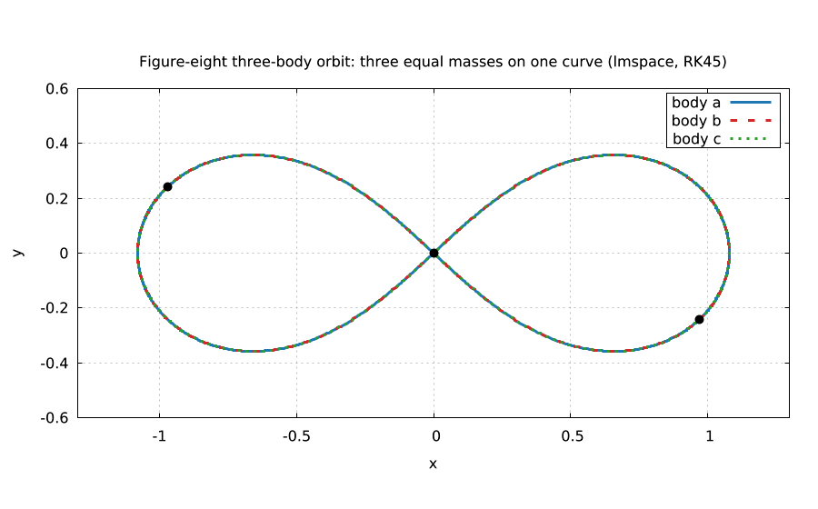
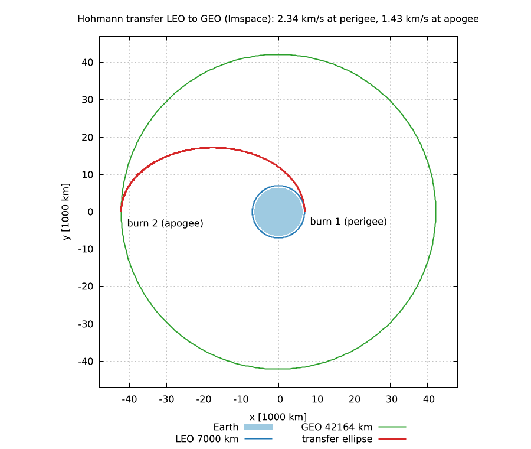
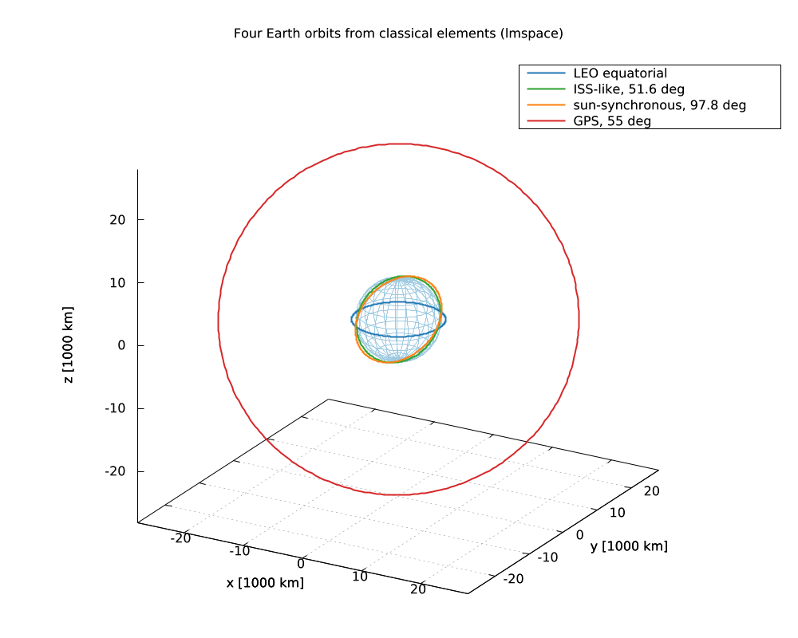
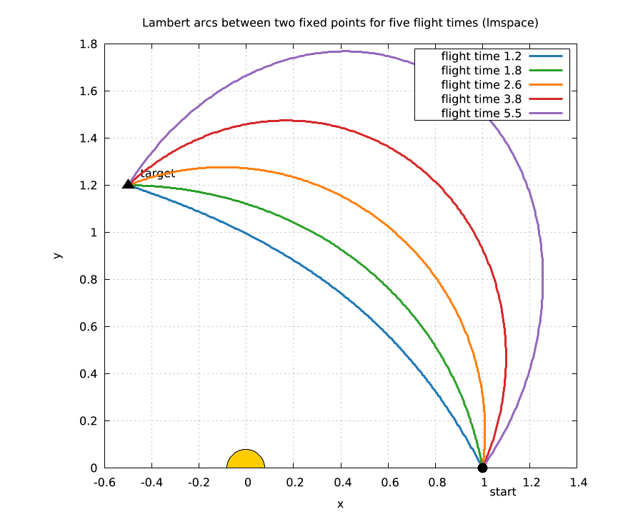
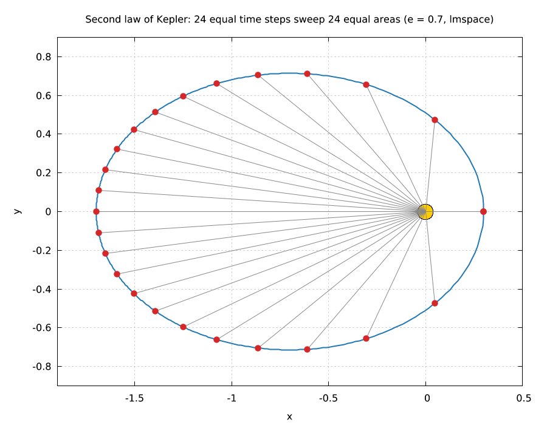
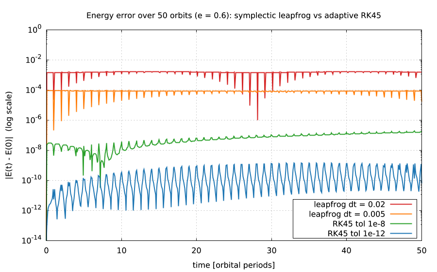
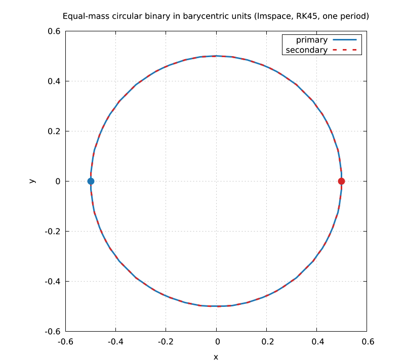
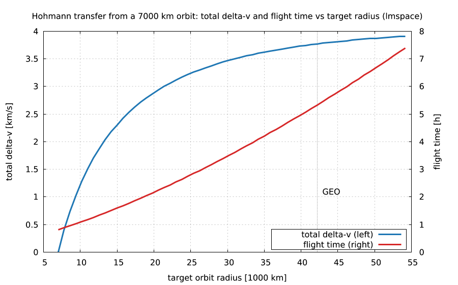

# lmspace

**Orbital mechanics for lmscript: N-body integration, Kepler, Lambert and Hohmann, SPICE frames, in one static executable.**

[](https://github.com/lmctl-ai/lmspace/actions/workflows/ci.yml)

|  |  |
| --- | --- |
| Figure-eight three-body orbit: three equal masses on one curve.<br>`lmctl autorun https://raw.githubusercontent.com/lmctl-ai/lmspace/main/examples/viz_figure_eight.lms` | Hohmann transfer from low orbit to geostationary radius, burns and flight time from `hohmann()`.<br>`lmctl autorun https://raw.githubusercontent.com/lmctl-ai/lmspace/main/examples/viz_hohmann.lms` |

|  |  |
| --- | --- |
| Four Earth orbits from classical elements: equatorial, ISS-like, sun-synchronous, GPS.<br>`lmctl autorun https://raw.githubusercontent.com/lmctl-ai/lmspace/main/examples/viz_orbits_3d.lms` | Lambert arcs between two fixed points for five flight times.<br>`lmctl autorun https://raw.githubusercontent.com/lmctl-ai/lmspace/main/examples/viz_lambert.lms` |

|  |  |
| --- | --- |
| Kepler second law: 24 equal time steps sweep 24 equal areas.<br>`lmctl autorun https://raw.githubusercontent.com/lmctl-ai/lmspace/main/examples/viz_second_law.lms` | Energy error over 50 eccentric orbits: leapfrog vs adaptive RK45.<br>`lmctl autorun https://raw.githubusercontent.com/lmctl-ai/lmspace/main/examples/viz_energy_error.lms` |

|  |  |
| --- | --- |
| Equal-mass binary, one period, closed form checked.<br>`lmctl autorun https://raw.githubusercontent.com/lmctl-ai/lmspace/main/examples/orbit_csv.lms` | Hohmann delta-v and flight time against target radius; Lambert check.<br>`lmctl autorun https://raw.githubusercontent.com/lmctl-ai/lmspace/main/examples/transfers.lms` |

Every picture is made by the script named under it: the script runs the computation with lmspace, draws with [lmplot](https://github.com/lmctl-ai/lmplot) and writes `images/` into the current directory. `examples/render-all.sh` regenerates `docs/images/`.

Orbital mechanics and astronomy for lmscript in one static executable. Original MIT numerical algorithms provide N-body integration, Kepler propagation, orbital elements, Lambert transfers and Hohmann maneuvers. NASA NAIF CSPICE provides frames and ephemerides from user-supplied kernels.

```lmscript
p = _dsl_ cli="lmspace" install="github:lmctl-ai/lmspace@latest";
let mu = 398600.4418;
let orbit = elements(7000.0, 0.1, 0.2, 0.3, 0.4, 0.5);
let initial = orbit.to_state(mu);
let transfer = hohmann(7000.0, 42164.0, mu);
assert_close(period(7000.0, mu), 5828.516637686015, 0.00000001);
transfer.save_csv("transfer.csv");
end _dsl_
savedsl(p, "transfer.dslb");
system ${dsl_cli(p)} --dsl transfer.dslb;
```

Run with `lmscript transfer.lms`. The compiler finds `lmspace` on PATH or installs the matching release binary. This is a scripting host: the CLI accepts only `--dsl [FILE ...]`, `--dry-run --dsl ...`, `--version`, `--notices`, `--dsl-schema [--json]` and `--dsl-signatures`. Usage errors exit 2; bytecode load and execution errors exit 3. Dry run verifies bytecode without executing it or writing files.

| API | Result |
| --- | --- |
| `space.body(name, mu, x, y, z, vx, vy, vz)` | body with gravitational parameter and Cartesian initial state |
| `space.system().add(body)` | independent N-body system; bodies are copied when added |
| `system.propagate(duration, points, step, method, tol)` | matrix with time and six Cartesian columns per body |
| `space.propagate(...)` | propagate all bodies created in this script context |
| `space.energy()`, `space.angular_momentum()` | invariants of the initial body states |
| `vector(x,y,z)`, `state(position,velocity)` | vector and Cartesian state objects |
| `elements(a,e,i,raan,argp,nu).to_state(mu)` | state from classical orbital elements |
| `to_elements(state,mu)`, `body.elements(central_mu)` | classical orbital elements |
| `body.propagate(central_mu,dt)` | exact elliptic/hyperbolic two-body propagation |
| `kepler(M,e)`, `period(a,mu)` | eccentric anomaly and orbital period |
| `hohmann(r1,r2,mu)` | 1×3 matrix: signed departure delta-v, arrival delta-v, transfer time |
| `lambert(r1,r2,dt,mu,prograde)` | 2×3 matrix: departure and arrival velocities |
| `space.load_kernel(path)` | load an explicit user-provided SPICE kernel or metakernel |
| `space.ephemeris(target,observer,frame,et)` | 1×6 geometric state matrix in km and km/s |
| `space.frame(from,to,et)` | 3×3 coordinate rotation matrix |
| `space.time(text)` | SPICE ephemeris time; UTC conversion requires a leap-second kernel |
| `assert_close(actual,expected,absolute_tolerance)` | numeric assertion; rejects NaN and infinity |
| `Matrix.rows/cols/get/save_csv` | 0-based matrix access and comma-separated output |

Angles are radians. Numerical mechanics accepts any consistent units; `mu` is G×mass, not mass in kg. With km and seconds, use km³/s² for `mu`. N-body energy and angular momentum use `mu` as mass, equivalent to G=1; their conservation is meaningful, while physical mass-weighted units require dividing by G. Propagation returns `points` rows, from t=0 to duration, with columns `t, x0,y0,z0,vx0,vy0,vz0, x1,...`. It returns a trajectory and leaves the initial bodies unchanged.

Choose `"symplectic"` for second-order kick–drift–kick leapfrog or `"rk45"` for adaptive Dormand–Prince 5(4). Leapfrog uses the requested maximum step, shortening at output boundaries. RK45 uses `step` as its initial trial step and `tol` as absolute-plus-relative local error control. These are original implementations, **not WHFast or IAS15**. No REBOUND code is used. Lambert supports the zero-revolution branch; collinear endpoints are rejected. Parabolic element-based propagation is not supported.

SPICE uses ET seconds past J2000, with no aberration correction (`NONE`). Build and kernel-free frame transforms need no data files. Ephemeris queries require user kernels covering the target, observer and epoch; missing data produces an execution error. lmspace never automatically downloads kernels. Results can be exported as CSV and plotted with [lmplot](https://github.com/lmctl-ai/lmplot).

## Examples and verification

Every program under [tests/](tests/) and [examples/](examples/) compiles and asserts known answers. `./test.sh` builds the binary, runs native physics tests and DSL programs, verifies pins/schema/signatures/notices/static linking, checks deterministic CSV reruns, and exercises usage, dry run and runtime errors. Native SPICE tests generate their own tiny synthetic SPK at runtime, with no downloaded kernels. Physics checks cover energy and angular momentum, Kepler's period, Hohmann delta-v, Lambert endpoints, orbital conversion degeneracies and Earth–Moon scales.

```sh
scripts/sync-deps.sh
cmake -S . -B build -DCMAKE_BUILD_TYPE=Release
cmake --build build --parallel 4
./test.sh
```

Requires C++17, CMake 3.24+, git, Python 3, and lmscript (`npm i -g @lmctl-ai/lmctl@0.2.369`) for the tests. Linux executables are fully static; macOS uses only system libraries; Windows statically links MinGW runtimes. Releases contain five platform binaries and the license notices.

## Resource limits

A program may use at most 4096 MiB in total (propagation tables, bodies, every object the host
keeps); beyond that it stops with a run error (exit 3) naming the limit, instead of exhausting the
machine. Set `LMSPACE_MAX_MEMORY_MB` to change it, e.g. `LMSPACE_MAX_MEMORY_MB=16384 lmscript big.lms`.

## License and scope

Our host and algorithms are [MIT](LICENSE). CSPICE N0067 is included under the [NAIF rules](https://naif.jpl.nasa.gov/naif/rules.html) and its Caltech/JPL/NASA disclaimer, reproduced in [THIRD_PARTY_NOTICES](THIRD_PARTY_NOTICES) and embedded in `--notices`. The pinned dependency is fetched into ignored `third_party/`; its source and kernels are not committed. The runtime SDK is MIT and pinned in `sdk.lock`. No GPL/AGPL scientific libraries are linked.

See [durable-memory](durable-memory/index.md) for design decisions and [remaining scope](durable-memory/08-open-items.md), including relativistic/finite-body effects, WHFast/IAS15, and multi-revolution Lambert transfers.
