# lmspace

**Orbital mechanics for lmscript: N-body integration, Kepler, Lambert and Hohmann, SPICE frames, in one executable.**

[](https://github.com/lmctl-ai/lmspace/actions/workflows/ci.yml)
[](https://github.com/lmctl-ai/lmspace/releases)
[](LICENSE)

### Missions and transfers

| 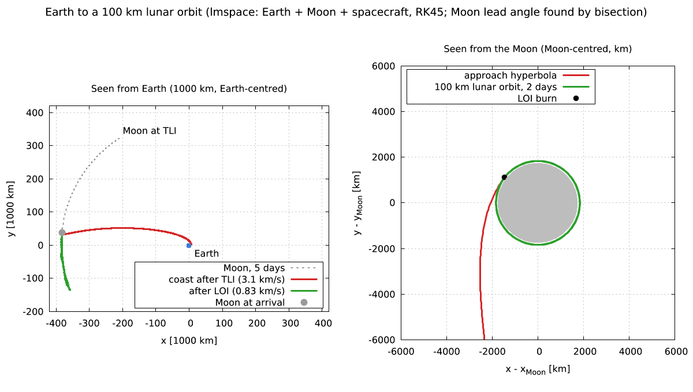 | 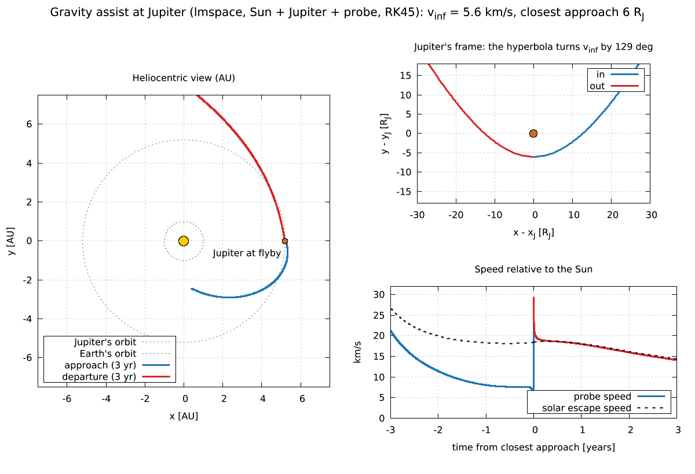 |
| --- | --- |
| Earth to a 100 km lunar orbit: 3.14 km/s TLI, 3.9-day coast, 0.83 km/s insertion; the Moon's lead angle found by bisection.<br>`lmctl https://raw.githubusercontent.com/lmctl-ai/lmspace/main/examples/viz_lunar_transfer.lms` | Jupiter flyby: the hyperbola turns v-infinity by 129 deg and the probe leaves 10 km/s faster, as patched conics predict.<br>`lmctl https://raw.githubusercontent.com/lmctl-ai/lmspace/main/examples/viz_gravity_assist.lms` |

| 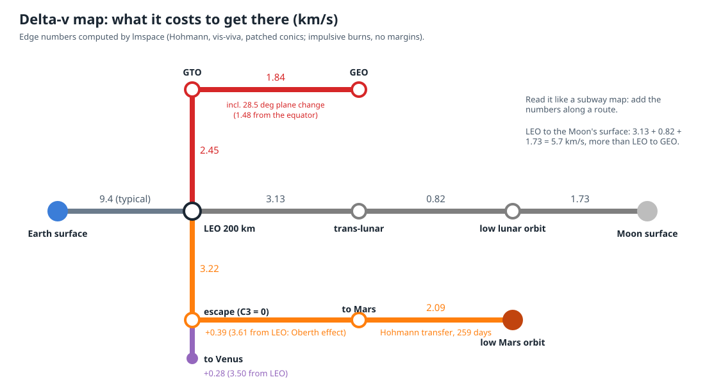 | 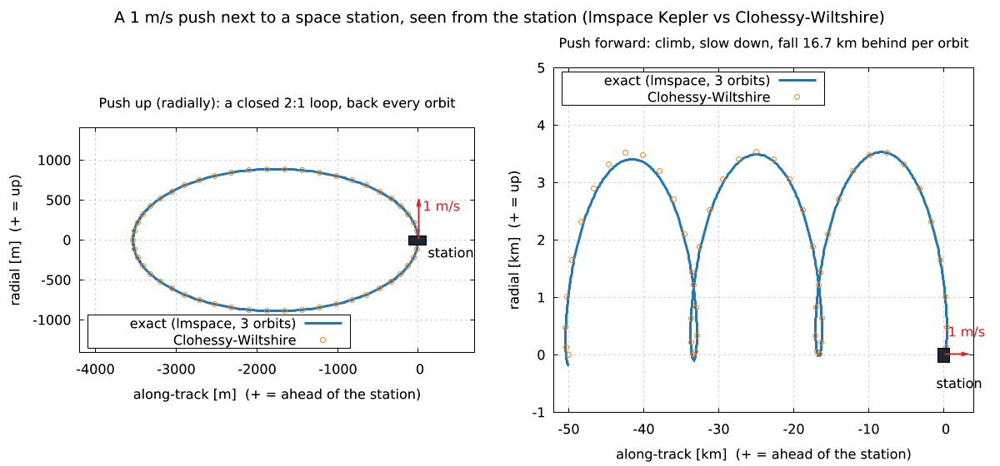 |
| --- | --- |
| Delta-v "subway map" of the Earth-Moon-Mars neighbourhood; every edge computed (Hohmann, vis-viva, patched conics).<br>`lmctl https://raw.githubusercontent.com/lmctl-ai/lmspace/main/examples/viz_delta_v_map.lms` | A 1 m/s push next to a space station: up gives a closed loop, forward makes you fall 16.7 km behind (Clohessy-Wiltshire check).<br>`lmctl https://raw.githubusercontent.com/lmctl-ai/lmspace/main/examples/viz_rendezvous.lms` |

| 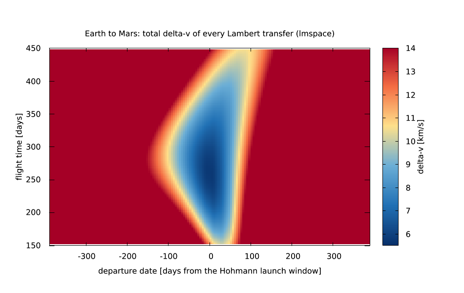 |  |
| --- | --- |
| Earth to Mars porkchop plot: delta-v of 1240 Lambert transfers; the minimum is the 5.6 km/s Hohmann window.<br>`lmctl https://raw.githubusercontent.com/lmctl-ai/lmspace/main/examples/viz_porkchop.lms` | Hohmann transfer from low orbit to geostationary radius, propagated and checked against both burns.<br>`lmctl https://raw.githubusercontent.com/lmctl-ai/lmspace/main/examples/viz_hohmann.lms` |

| 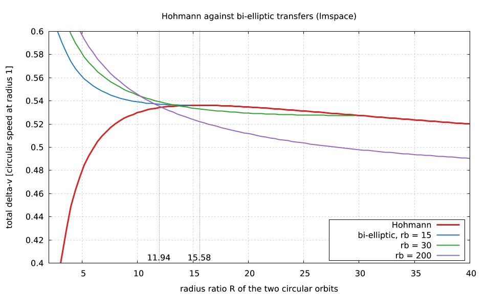 |  |
| --- | --- |
| Hohmann against bi-elliptic transfers: the textbook crossovers at radius ratios 11.94 and 15.58.<br>`lmctl https://raw.githubusercontent.com/lmctl-ai/lmspace/main/examples/viz_bielliptic.lms` | Lambert arcs between two fixed points for five flight times.<br>`lmctl https://raw.githubusercontent.com/lmctl-ai/lmspace/main/examples/viz_lambert.lms` |

|  |  |
| --- | --- |
| Hohmann delta-v and flight time against target radius; Lambert check.<br>`lmctl https://raw.githubusercontent.com/lmctl-ai/lmspace/main/examples/transfers.lms` |  |

### Earth orbits

| 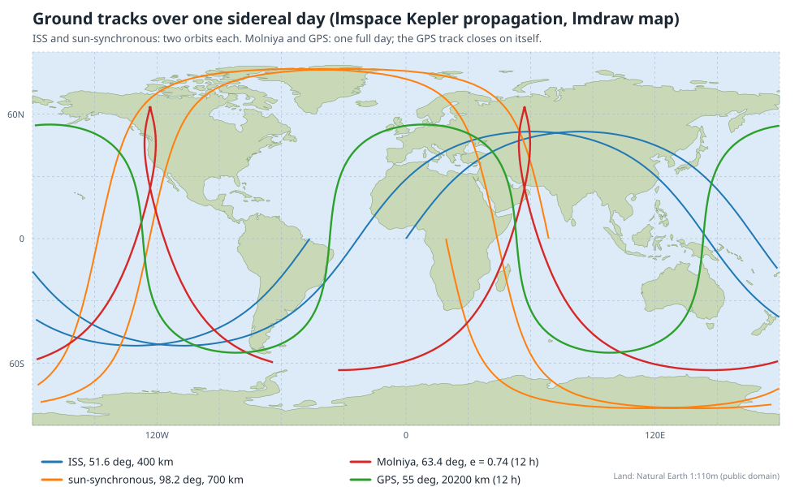 | 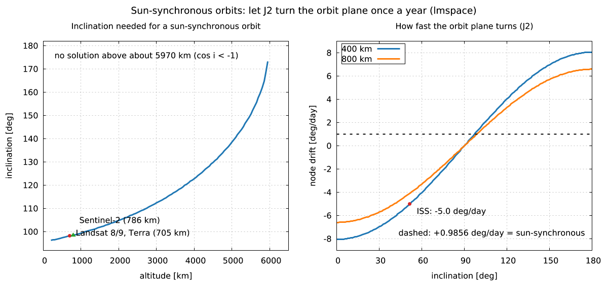 |
| --- | --- |
| Ground tracks of the ISS, a sun-synchronous orbit, Molniya and GPS over one sidereal day, on a Natural Earth map (lmdraw).<br>`lmctl https://raw.githubusercontent.com/lmctl-ai/lmspace/main/examples/viz_ground_tracks.lms` | Sun-synchronous design: the J2 inclination for every altitude (Landsat 98.2 deg at 705 km) and node drift rates.<br>`lmctl https://raw.githubusercontent.com/lmctl-ai/lmspace/main/examples/viz_sun_synchronous.lms` |

| 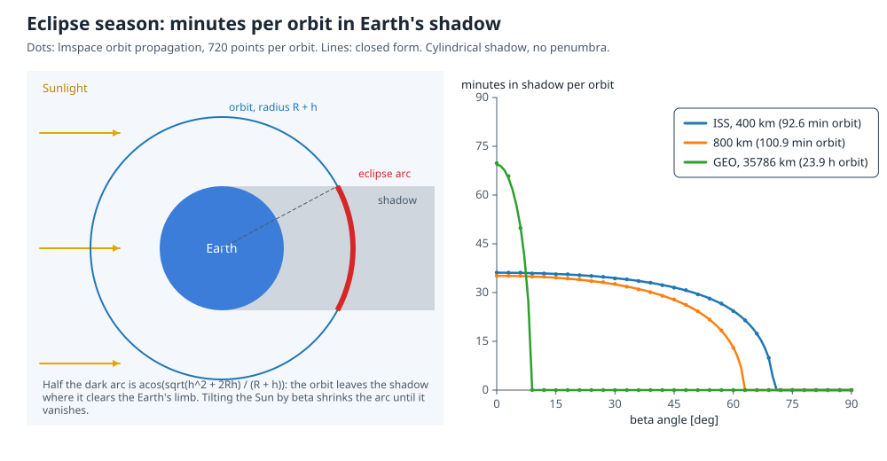 | 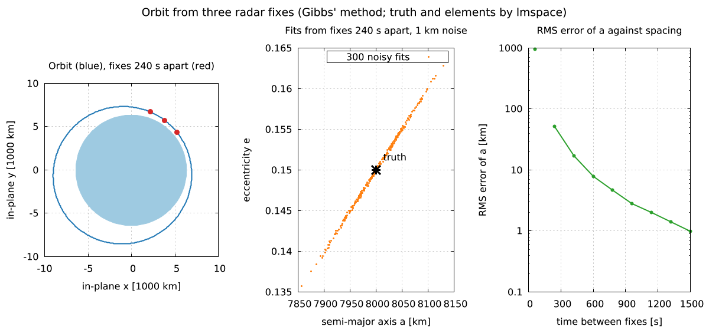 |
| --- | --- |
| Minutes in Earth's shadow against the beta angle: ISS 36 min at most, GEO only near the equinoxes (lmdraw).<br>`lmctl https://raw.githubusercontent.com/lmctl-ai/lmspace/main/examples/viz_eclipse.lms` | Orbit from three radar fixes (Gibbs' method): 300 noisy fits per spacing; error drops 1000-fold as fixes spread.<br>`lmctl https://raw.githubusercontent.com/lmctl-ai/lmspace/main/examples/viz_orbit_determination.lms` |

| 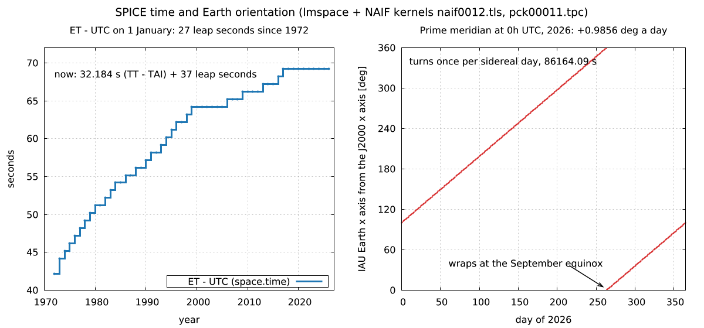 |  |
| --- | --- |
| SPICE with NAIF kernels: 27 leap seconds since 1972, and the sidereal day from the IAU_EARTH frame.<br>`lmctl https://raw.githubusercontent.com/lmctl-ai/lmspace/main/examples/viz_spice_time.lms` | Four Earth orbits from classical elements: equatorial, ISS-like, sun-synchronous, GPS.<br>`lmctl https://raw.githubusercontent.com/lmctl-ai/lmspace/main/examples/viz_orbits_3d.lms` |

### Three bodies and more

| 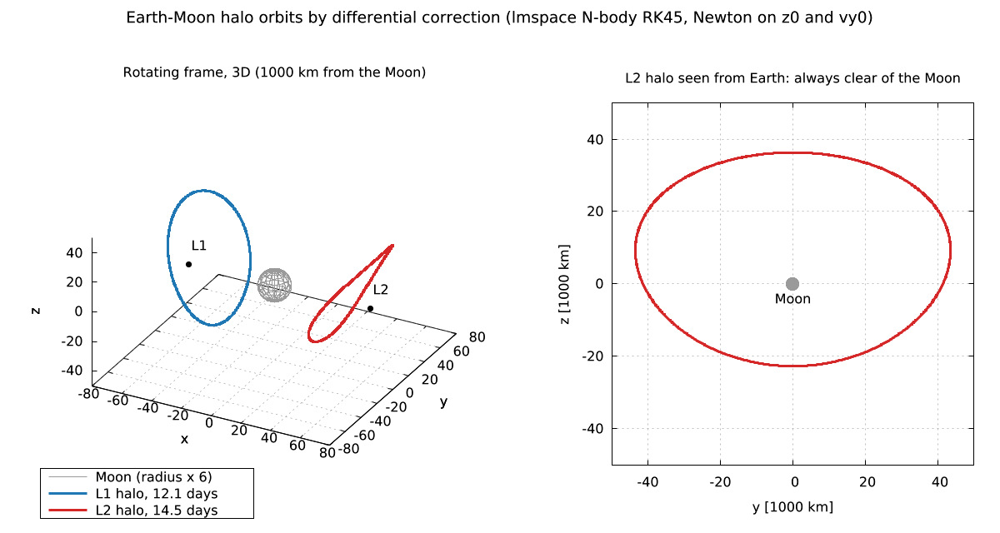 | 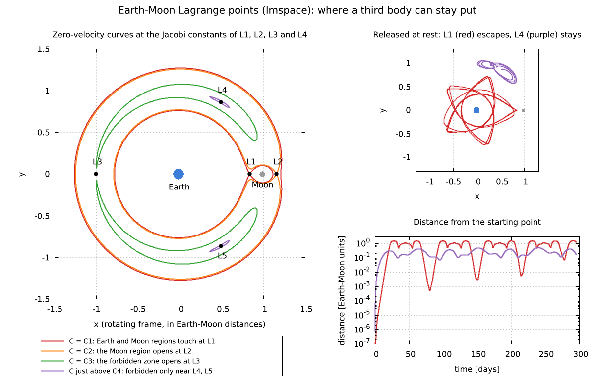 |
| --- | --- |
| Earth-Moon L1 and L2 halo orbits by differential correction; from Earth the L2 halo never hides behind the Moon.<br>`lmctl https://raw.githubusercontent.com/lmctl-ai/lmspace/main/examples/viz_halo_orbits.lms` | Lagrange points and zero-velocity curves; a particle at L1 escapes within weeks, one near L4 stays.<br>`lmctl https://raw.githubusercontent.com/lmctl-ai/lmspace/main/examples/viz_lagrange.lms` |

| 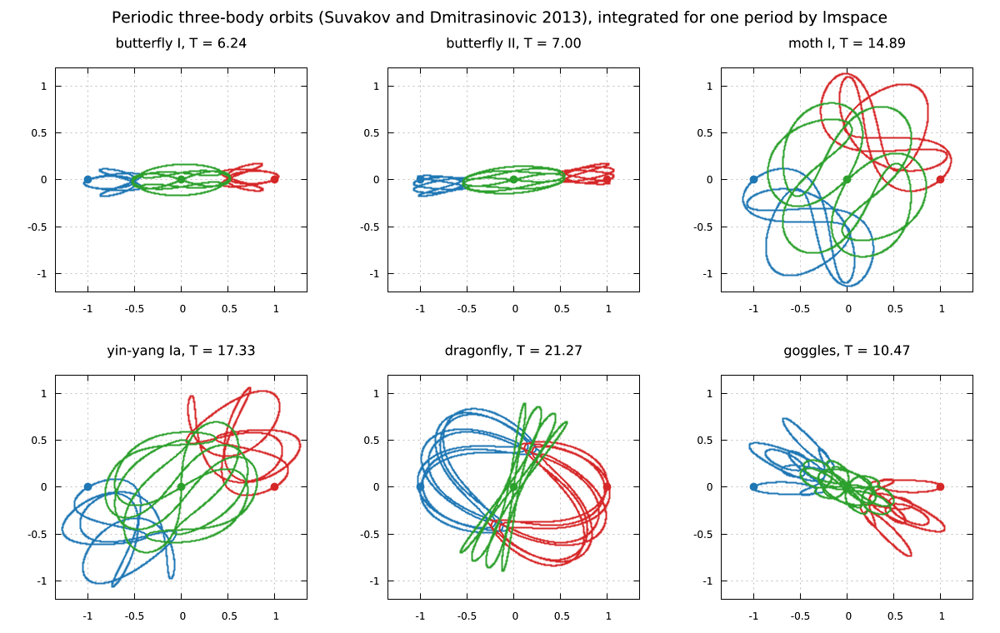 | 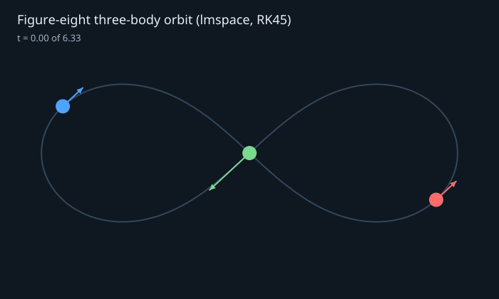 |
| --- | --- |
| Six periodic three-body orbits from Suvakov and Dmitrasinovic (2013), each closing after one period.<br>`lmctl https://raw.githubusercontent.com/lmctl-ai/lmspace/main/examples/viz_three_body_zoo.lms` | The figure-eight choreography: three equal masses chase each other on one curve (needs ffmpeg).<br>`lmctl https://raw.githubusercontent.com/lmctl-ai/lmspace/main/examples/anim_figure_eight.lms` |

| 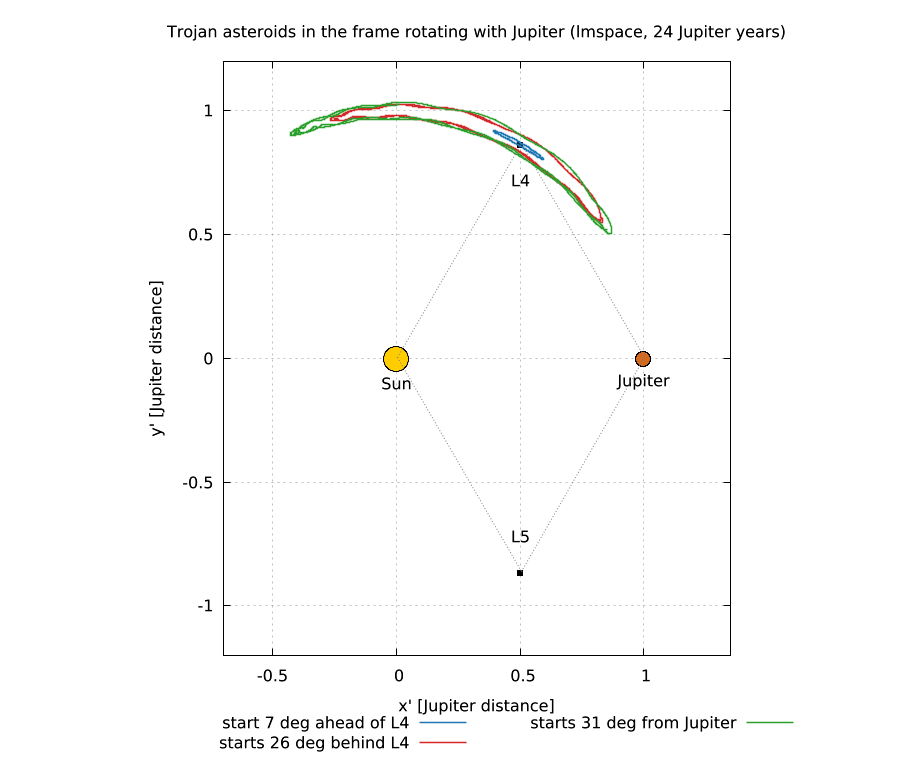 |  |
| --- | --- |
| Trojan asteroids librate around Jupiter's L4 point in the rotating frame.<br>`lmctl https://raw.githubusercontent.com/lmctl-ai/lmspace/main/examples/viz_trojans.lms` | The figure-eight orbit integrated for one period with RK45.<br>`lmctl https://raw.githubusercontent.com/lmctl-ai/lmspace/main/examples/viz_figure_eight.lms` |

### The Solar System and Kepler's laws

| 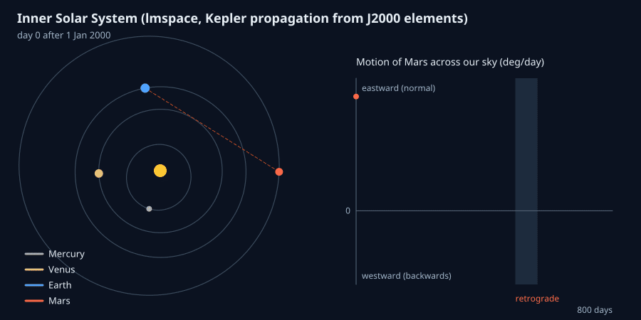 | 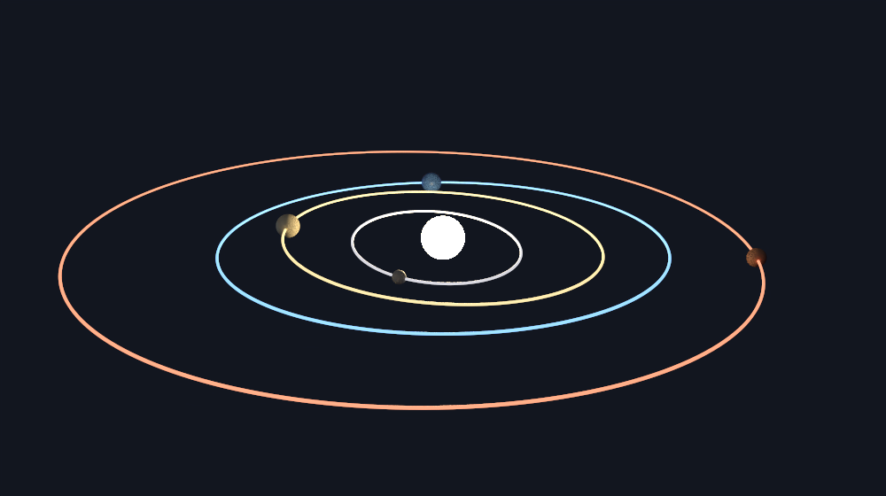 |
| --- | --- |
| 800 days of the inner planets from J2000 elements; Mars turns backwards in our sky at the June 2001 opposition (needs ffmpeg).<br>`lmctl https://raw.githubusercontent.com/lmctl-ai/lmspace/main/examples/anim_solar_system.lms` | The inner planets' orbits as real 3D curves, path-traced by lmblender (Cycles).<br>`lmctl https://raw.githubusercontent.com/lmctl-ai/lmspace/main/examples/render_solar_system.lms` |

|  |  |
| --- | --- |
| Halley's comet: 75 years, 54.5 km/s at perihelion, 0.9 km/s at aphelion beyond Neptune.<br>`lmctl https://raw.githubusercontent.com/lmctl-ai/lmspace/main/examples/viz_halley.lms` | Kepler's second law: 24 equal time steps sweep 24 equal areas.<br>`lmctl https://raw.githubusercontent.com/lmctl-ai/lmspace/main/examples/viz_second_law.lms` |

| 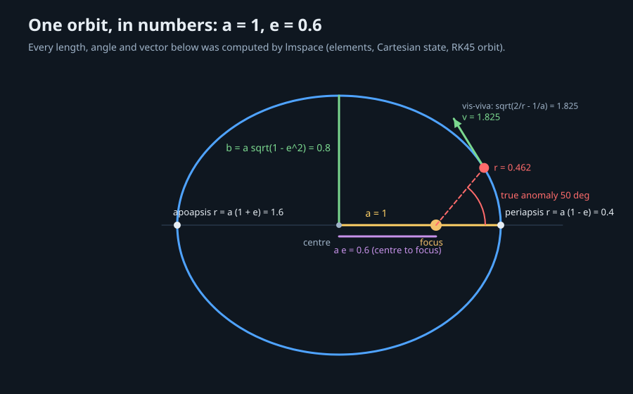 |  |
| --- | --- |
| One orbit in numbers: a, b, a e, true anomaly and velocity from lmspace (lmdraw).<br>`lmctl https://raw.githubusercontent.com/lmctl-ai/lmspace/main/examples/viz_orbit_elements.lms` | Energy error over 50 eccentric orbits: leapfrog against adaptive RK45.<br>`lmctl https://raw.githubusercontent.com/lmctl-ai/lmspace/main/examples/viz_energy_error.lms` |

|  |  |
| --- | --- |
| Equal-mass binary, one period, closed form checked.<br>`lmctl https://raw.githubusercontent.com/lmctl-ai/lmspace/main/examples/orbit_csv.lms` |  |

Every picture is made by the script named under it: it runs the computation with lmspace, draws with [lmplot](https://github.com/lmctl-ai/lmplot), [lmdraw](https://github.com/lmctl-ai/lmdraw) or [lmblender](https://github.com/lmctl-ai/lmblender) and writes `images/` into the current directory. All 28 run on released lmspace v0.1.2 or newer. Two fetch data over HTTP (a Natural Earth map, two NAIF kernels); the GIFs need ffmpeg. `examples/render-all.sh` regenerates `docs/images/`.

**Quick start:** `npm i -g @lmctl-ai/lmctl`, then paste any `lmctl autorun` line above into a terminal; it downloads lmspace and the drawing host and writes the picture to `images/`.

Linux downloads require **dynamic glibc >= 2.35** (Ubuntu 22.04 or newer).

Orbital mechanics and astronomy for lmscript in one executable. Original MIT numerical algorithms provide N-body integration, Kepler propagation, orbital elements, Lambert transfers and Hohmann maneuvers. NASA NAIF CSPICE provides frames and ephemerides from user-supplied kernels.

```lmscript
p = _lmcode_ cli="lmspace" install="github:lmctl-ai/lmspace@latest";
let mu = 398600.4418;
let orbit = elements(7000.0, 0.1, 0.2, 0.3, 0.4, 0.5);
let initial = orbit.to_state(mu);
let transfer = hohmann(7000.0, 42164.0, mu);
assert_close(period(7000.0, mu), 5828.516637686015, 0.00000001);
transfer.save_csv("transfer.csv");
end _lmcode_
savedsl(p, "transfer.dslb");
system ${dsl_cli(p)} --dsl transfer.dslb;
```

Run with `lmscript transfer.lms`. The compiler finds `lmspace` on PATH or installs the matching release binary. This is a scripting host: the CLI accepts only `--dsl [FILE ...]`, `--dry-run --dsl ...`, `--version`, `--notices`, `--dsl-schema [--json]` and `--dsl-signatures`. Usage errors exit 2; bytecode load and execution errors exit 3. Dry run verifies bytecode without executing it or writing files.

| API | Result |
| --- | --- |
| `space.body(name, mu, x, y, z, vx, vy, vz)` | body with gravitational parameter and Cartesian initial state |
| `space.system().add(body)` | independent N-body system; bodies are copied when added |
| `system.propagate(duration, points, step, method, tol)` | matrix with time and six Cartesian columns per body |
| `space.propagate(...)` | propagate all bodies created in this script context |
| `space.energy()`, `space.angular_momentum()` | invariants of the initial body states |
| `system.energy_drift()`, `space.energy_drift()` | largest relative energy change of the last `propagate` |
| `vector(x,y,z)`, `state(position,velocity)` | vector and Cartesian state objects |
| `elements(a,e,i,raan,argp,nu).to_state(mu)` | state from classical orbital elements |
| `to_elements(state,mu)`, `body.elements(central_mu)` | classical orbital elements |
| `body.propagate(central_mu,dt)` | exact elliptic/hyperbolic two-body propagation |
| `kepler(M,e)`, `period(a,mu)` | eccentric anomaly and orbital period |
| `hohmann(r1,r2,mu)` | 1×3 matrix: signed departure delta-v, arrival delta-v, transfer time |
| `lambert(r1,r2,dt,mu,prograde)` | 2×3 matrix: departure and arrival velocities |
| `space.load_kernel(path)` | load an explicit user-provided SPICE kernel or metakernel; a file that is neither a binary (DAF/DAS) kernel nor a text kernel with `\begindata` is rejected (from v0.1.2) |
| `space.ephemeris(target,observer,frame,et)` | 1×6 geometric state matrix in km and km/s |
| `space.frame(from,to,et)` | 3×3 coordinate rotation matrix |
| `space.time(text)` | SPICE ephemeris time; UTC conversion requires a leap-second kernel |
| `assert_close(actual,expected,absolute_tolerance)` | numeric assertion; rejects NaN and infinity |
| `Matrix.rows/cols/get/save_csv` | 0-based matrix access and comma-separated output |

Angles are radians. Numerical mechanics accepts any consistent units; `mu` is G×mass, not mass in kg. With km and seconds, use km³/s² for `mu`. N-body energy and angular momentum use `mu` as mass, equivalent to G=1; their conservation is meaningful, while physical mass-weighted units require dividing by G. Propagation returns `points` rows, from t=0 to duration, with columns `t, x0,y0,z0,vx0,vy0,vz0, x1,...`. It returns a trajectory and leaves the initial bodies unchanged.

Choose `"symplectic"` for second-order kick–drift–kick leapfrog or `"rk45"` for adaptive Dormand–Prince 5(4). Leapfrog uses the requested maximum step, shortening at output boundaries. RK45 uses `step` as its initial trial step and `tol` as absolute-plus-relative local error control. These are original implementations, **not WHFast or IAS15**. Every propagation tracks the mass-weighted system energy; when it drifts by more than 1e-3 of its scale (a fixed step through a close encounter, say), lmspace prints a warning on stderr and `energy_drift()` returns the value (from v0.1.2). Test particles with tiny `mu` hardly move the total, so check them against a known invariant yourself. No REBOUND code is used. Lambert supports the zero-revolution branch; collinear endpoints are rejected. Parabolic element-based propagation is not supported.

SPICE uses ET seconds past J2000, with no aberration correction (`NONE`). Build and kernel-free frame transforms need no data files. Ephemeris queries require user kernels covering the target, observer and epoch; missing data produces an execution error. lmspace never automatically downloads kernels. Results can be exported as CSV and plotted with [lmplot](https://github.com/lmctl-ai/lmplot).

## Examples and verification

Every program under [tests/](tests/) and [examples/](examples/) compiles and asserts known answers. `./test.sh` builds the binary, runs native physics tests and DSL programs, verifies pins, schema, signatures, notices and the Linux dependency/ABI policy, checks deterministic CSV reruns, and exercises usage, dry run and runtime errors. Native SPICE tests generate their own tiny synthetic SPK at runtime, with no downloaded kernels. Physics checks cover energy and angular momentum, Kepler's period, Hohmann delta-v, Lambert endpoints, orbital conversion degeneracies and Earth–Moon scales.

```sh
scripts/sync-deps.sh
cmake -S . -B build -DCMAKE_BUILD_TYPE=Release
cmake --build build --parallel 4
./test.sh
```

Requires C++17, CMake 3.24+, git, Python 3, and lmscript (`npm i -g @lmctl-ai/lmctl@0.2.420`) for the tests. Linux uses dynamic glibc >= 2.35, with CSPICE and the GCC C++ runtimes static; macOS uses only system libraries; Windows statically links MinGW runtimes. Releases contain five platform binaries and the license notices.

`lmspace --version` remains exactly `lmspace X.Y.Z` for installer compatibility.
The Linux runtime baseline applies to x64 and ARM64; no relink-object archive
or third-party shared libraries are required.

## Resource limits

A program may use at most 4096 MiB in total (propagation tables, bodies, every object the host
keeps); beyond that it stops with a run error (exit 3) naming the limit, instead of exhausting the
machine. Set `LMSPACE_MAX_MEMORY_MB` to change it, e.g. `LMSPACE_MAX_MEMORY_MB=16384 lmscript big.lms`.

## License and scope

Our host and algorithms are [MIT](LICENSE). CSPICE N0067 is included under the [NAIF rules](https://naif.jpl.nasa.gov/naif/rules.html) and its Caltech/JPL/NASA disclaimer, reproduced in [THIRD_PARTY_NOTICES](THIRD_PARTY_NOTICES) and embedded in `--notices`. The pinned dependency is fetched into ignored `third_party/`; its source and kernels are not committed. The runtime SDK is MIT and pinned in `sdk.lock`. No GPL/AGPL scientific libraries are linked.

See [durable-memory](durable-memory/index.md) for design decisions and [remaining scope](durable-memory/08-open-items.md), including relativistic/finite-body effects, WHFast/IAS15, and multi-revolution Lambert transfers.
